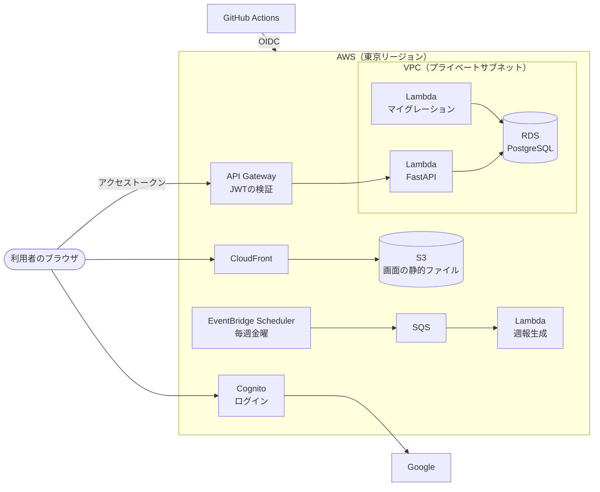

# moodLog

直感的なアイコンや短文で気楽に心情や行動を記録し、週末に1週間の記録を振り返り、翌週以降の行動を改善するアプリケーション。

個人開発のプロジェクトで、AWS 上の構成を自分で設計・運用することも目的にしている。

## 何を解決するか

日常を振り返る機会を増やし、より良い生活を送れる人を増やす。

### 対象ユーザー

- 週報や半期に一度の振り返り等で自身の行動を思い出せない社会人
- 最近の出来事を聞かれても回答できず、日常会話に困っている人

### 解消するユーザーの課題

- 従来の日記アプリやメモで記録する場合、情報を整理して記録するために、ある程度思考を言語化できた状態で書き始める必要がある
- 絵文字で直感的に気持ちを記録する競合アプリは、選択肢が多すぎる、記録を振り返る機会がなく示唆を得られにくいといった点から結果を得られない

## 機能と開発状況

2026年10月時点。初期リリースのコア機能は次の3つ。

| 機能 | 状況 | 内容 |
| --- | --- | --- |
| ログイン | ✅ できている | Google アカウントか、メールアドレスでログインする（Amazon Cognito） |
| 日次の1行記録 | ✅ できている | その日の気分を3つのアイコン（良い・ふつう・悪い）から選び、140文字までの短文を添える。直近7日の記録を一覧で見られる |
| 週末のふりかえりのまとめ | 🚧 作っている途中 | 毎週金曜に起動する仕組み（EventBridge Scheduler → SQS → Lambda）はできている。まとめを作る方法（LLM を使うかどうか）を検討中（[#32](https://github.com/technoirKarasu/moodLog/issues/32)） |

アプリは AWS 上の公開 URL で動いている。main ブランチへのマージで、本番へ自動でデプロイされる。

初期リリースではやらないこと（それ以降で対応予定）:

- ウィジェットからの入力
- ネイティブアプリ

### このあとの予定

- 週末のまとめの生成方法を決め、実装する（[#32](https://github.com/technoirKarasu/moodLog/issues/32)）
- 運用の守りを固める: 依存ライブラリの版の固定（[#84](https://github.com/technoirKarasu/moodLog/issues/84)）
- 実際の PostgreSQL を使った自動テスト（[#77](https://github.com/technoirKarasu/moodLog/issues/77)）

ほかの作業は [Issues](https://github.com/technoirKarasu/moodLog/issues) にある。

## システム構成

- 画面は Next.js で静的なファイルに書き出し、S3 に置いて CloudFront から配信する。サーバーで画面を作らない
- API は FastAPI を Lambda で動かす（Mangum）。API Gateway がログインのトークン（JWT）を確かめてから、Lambda に渡す
- DB（RDS）と、DB を使う Lambda（API・マイグレーション）は、インターネットから入れないプライベートサブネットに置く。本番 DB へのマイグレーションは、同じ VPC にある専用の Lambda から流す
- 週報生成の Lambda は、今は起動されたことをログに残すだけで、DB にはまだつないでいない（まとめの生成方法を決めてから作る）
- インフラはすべて Terraform で管理する

## 技術スタック

| 層 | 使っているもの | 選んだ理由 |
| --- | --- | --- |
| 画面 | Next.js（TypeScript、静的エクスポート）、Tailwind CSS、[デジタル庁デザインシステム（DADS）](https://design.digital.go.jp/) | [ADR 0005](docs/adr/0005-frontend-hosting.md)、[ADR 0008](docs/adr/0008-dads.md) |
| API | FastAPI（Python）、SQLAlchemy、Alembic | [ADR 0003](docs/adr/0003-compute.md) |
| 実行環境 | AWS Lambda + API Gateway | [ADR 0003](docs/adr/0003-compute.md) |
| DB | Amazon RDS for PostgreSQL | [ADR 0002](docs/adr/0002-database.md) |
| ログイン | Amazon Cognito（Google・メールアドレス）、oidc-client-ts | [ADR 0009](docs/adr/0009-auth.md)、[ADR 0010](docs/adr/0010-token-storage.md) |
| 非同期処理 | EventBridge Scheduler → SQS → Lambda | [ADR 0004](docs/adr/0004-async.md) |
| ネットワーク | VPC（プライベートサブネット） | [ADR 0007](docs/adr/0007-vpc.md) |
| IaC | Terraform（state は S3） | |
| CI/CD | GitHub Actions（OIDC で AWS に認証） | [ADR 0012](docs/adr/0012-deploy.md) |

Supabase・Firebase・Vercel などの BaaS / PaaS は使わない。AWS の構成と運用を自分で持つことが目的のため（[ADR 0001](docs/adr/0001-supabase.md)）。

## 開発の進め方

[Claude Code](https://claude.com/claude-code) を使って開発している。AI に書かせたコードを人が理解し、判断の理由を後から追えることを重視して、次の流れで進める。

1. **Issue を立てる**: 作業はすべて Issue から始める。作業中に気づいた別の問題は、その場で直さず別の Issue にする
2. **計画を書く**（大きな変更のみ）: 仕様・設計（採る案と採らない案）・テスト計画を Issue のコメントに書く。設計や構成の判断は [ADR](docs/adr/) に残す
3. **独立したレビュー**: 実装の経緯を知らない別の AI のエージェントが、計画と差分をレビューする
4. **機械判定**: PR ごとに GitHub Actions でテストと静的解析を流す。通らないと main にマージできない

   | 対象 | 判定 |
   | --- | --- |
   | Backend | pytest、ruff |
   | Frontend | ESLint、TypeScript の型チェック |
   | Terraform | `terraform fmt -check`、`terraform validate` |

5. **人がマージする**: PR のマージは人が行う。マージすると、本番へ自動でデプロイされる（削除や作り直しを含むインフラの変更は、自動では反映せずに止まる）

コードの設計原則は [docs/design-principles.md](docs/design-principles.md)、AI への作業指示は [CLAUDE.md](CLAUDE.md) にある。

## リポジトリ構成

| パス | 内容 |
| --- | --- |
| [`frontend/`](frontend/) | 画面（Next.js） |
| [`backend/`](backend/) | API・バッチ・マイグレーション（FastAPI、Alembic） |
| [`infra/`](infra/) | AWS のインフラ（Terraform）。デプロイの手順もここにある |
| [`docs/adr/`](docs/adr/) | 設計判断の記録（ADR） |
| [`.github/workflows/`](.github/workflows/) | CI（PR のチェック）とデプロイ |

手元で動かす手順は、各ディレクトリの README にある。
